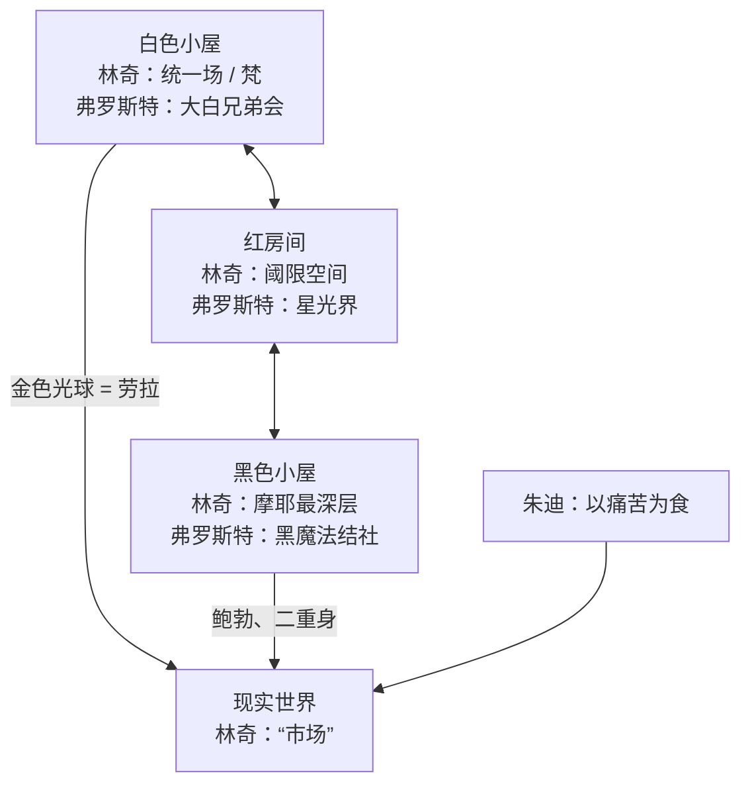
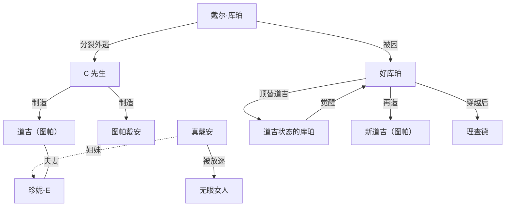

# 给 Claude Design 的交接文档｜电影巨辩 EP25《双峰》可视化

> 这份文档是自足的：不需要原始转录，也不需要另一份总结文档，照着这里的数据和文案就能做。
> 所有数据来自对播客 ASR 转录的整理。标了"推断""补注"的内容请按标注处理，不要当成确定事实放大展示。

---

## 0. 任务

**要做什么**：把一期 2 小时 09 分的中文电影播客做成一组可视化，让没听过的人三分钟看懂脉络，听过的人能当索引用。

**这期在讲什么**：两位影评人（老马 / magasa，阿吴 / LOOK）聊大卫·林奇和马克·弗罗斯特的剧集《双峰》。他们不解谜，而是讲"这部剧是怎么被构思出来的"：先讲电视产业和制作史，再分别用林奇的吠陀哲学、弗罗斯特的神智学两套世界观，把同一部剧各解释一遍。

**一句话主旨**（可做主标题下的副题）：

> 这部剧的核心，不是"谁杀了劳拉"，而是"劳拉是谁"。

**节目信息**

| 项 | 值 |
|---|---|
| 节目 | 电影巨辩 |
| 期数与标题 | 第 25 期《〈双峰〉是我俩心中最伟大的剧集》 |
| 主播 | 老马（magasa）、阿吴（LOOK） |
| 时长 | 2:09:28（129.5 分钟） |
| 语言 | 简体中文 |

**受众**：影迷、播客听众。默认读者知道《双峰》是什么，但不一定看过第三季，更不熟悉吠陀哲学和神智学。

**产出形式**：一个可滚动的长页面，由下面的模块组成；每个模块也要能单独截成一张竖版卡片（建议 4:5）。模块有优先级，时间不够先做 P0。

---

## 1. 使用规则

1. **不用剧照、海报、演员肖像、官方标志和片头字体**，也不要复刻剧中具体画面的构图。用抽象母题（见第 2 节）。
2. **数字以本文件为准**，不要自己补充或改写数据。
3. **说话人归属是推断的**（转录没有说话人标注）。可视化里尽量不写"老马说 / 阿吴说"；确实需要时写"主播之一""另一位主播"。
4. **两套世界观是主播的阐释**，不是官方设定。相关模块请加一行小字："以下为节目中的解读"。
5. 标了"节目口述"的数字来自主播原话；第 9 节列了几处与公开资料不一致的地方，对应模块请用那里的修正说法或加注。
6. 译名统一用第 8 节的表。

---

## 2. 视觉方向

**气质**：太平洋西北岸的小镇夜晚，安静、潮湿、有一点不对劲。克制，不要恐怖片海报感，也不要信息图模板感。

**色板与语义**（语义要贯穿所有模块，同一个对象始终同一个颜色）

| 名称 | 色值 | 用在哪 |
|---|---|---|
| 幕布红 | `#8E1B1B` | 林奇、林奇视角、红房间 |
| 松林绿 | `#1F3D36` | 弗罗斯特、弗罗斯特视角 |
| 光球金 | `#D9A441` | 劳拉、白色小屋、统一场、"向善" |
| 深夜黑 | `#111111` | 黑色小屋、鲍勃、朱迪、"沉沦" |
| 蓝玫瑰 | `#3A5BA0` | 未解之谜、蓝玫瑰小队、图帕 |
| 雾灰 | `#8A8F93` | 电视网、产业、中性信息 |
| 象牙白 | `#F2EBDD` | 底色 |

颜色不能单独承担含义：林奇 / 弗罗斯特、向善 / 沉沦这类成对信息，同时用文字标签或形状区分。

**母题**（抽象几何，选用，不必全上）

- 人字形锯齿纹（黑白相间），用作分隔带或阈限空间的底纹
- 垂直褶皱的幕帘线条
- 两座山的剪影（"双"峰，也对应"双重作者"）
- 松林剪影、电线与电流的折线
- 一枚金色圆球
- 一朵蓝色玫瑰的线描

**字体建议**：标题用中文衬线体（如思源宋体），正文用无衬线体（如思源黑体），数字用等宽或表格数字。

**版式**：信息密度高的模块（脑图、关系图）给足留白；金句卡要大字、少元素。

---

## 3. 模块总览

| # | 模块 | 建议形式 | 优先级 | 数据位置 |
|---|---|---|---|---|
| M1 | 封面 | 标题卡 | P0 | 第 0 节 |
| M2 | 十个要点 | 编号列表卡 | P0 | 4.2 |
| M3 | 全期脑图 | 放射状或树状脑图 | P0 | 4.3 |
| M4 | 两小时都聊了什么 | 一条按时间比例切分的横条 + 图例 | P0 | 4.4 |
| M5 | 为什么是 1990 年 | 阶梯下降图 + 三股力量示意 | P1 | 4.5 |
| M6 | 谜底之争 | 三方立场卡 + 事件流程 + 三个大数字 | P0 | 4.6 |
| M7 | 三十年时间线 | 横向时间线 | P1 | 4.7 |
| M8 | 双重作者 | 左右对开，中间"第三个实体" | P0 | 4.8 |
| M9 | 宇宙结构：一套设定，两种读法 | 三层纵向结构图，左右双注释 | P0 | 4.9 |
| M10 | 库珀的分裂与图帕 | 关系图 | P0 | 4.10 |
| M11 | 劳拉：从尸体到光球 | 五步演变条 | P1 | 4.11 |
| M12 | 谁变好了，谁沉下去了 | 斜率图或上下箭头矩阵 | P1 | 4.12 |
| M13 | 缺席的人，林奇的解法 | 成对卡片 | P2 | 4.13 |
| M14 | 前两季 vs 第三季 | 对照表 | P1 | 4.14 |
| M15 | 被重写的美国史 | 纵向时间线 | P1 | 4.15 |
| M16 | 提及频次 | 三组横向条形图 | P1 | 4.16 |
| M17 | 金句卡 | 大字引文，6–8 张 | P0 | 4.17 |
| M18 | 主播的分歧 | 正反卡片 | P2 | 4.18 |

建议的页面顺序：M1 → M2 → M3 → M4 → M5 → M6 → M7 → M8 → M9 → M10 → M11 → M12 → M13 → M14 → M15 → M16 → M18 → M17（金句也可以拆开，穿插在各模块之间做呼吸）。

---

## 4. 各模块的数据与文案

### 4.1 M1 封面

- 主标题：《双峰》是我俩心中最伟大的剧集
- 眉题：电影巨辩 · 第 25 期
- 副题：不是"谁杀了劳拉"，而是"劳拉是谁"
- 角标：老马 × 阿吴｜2 小时 09 分
- 视觉：两座山的剪影叠在锯齿纹上，一枚金球悬在两山之间。

### 4.2 M2 十个要点

```json
[
  {"n": 1, "title": "产业转折的产物", "text": "三大电视网份额从 90% 多跌到约 50%，长期排第三的 ABC 才敢赌一把。"},
  {"n": 2, "title": "真正的冲突在幕后", "text": "林奇想让谜底永远悬着，电视网和观众要答案，弗罗斯特夹在中间。"},
  {"n": 3, "title": "不能没有第三季", "text": "没有第三季，这部剧算不上善始善终。第三季延续的是《与火同行》的拍法。"},
  {"n": 4, "title": "双重作者", "text": "林奇定基调和意象，弗罗斯特搭结构和神话。两人称之为“第三个实体”。"},
  {"n": 5, "title": "一套设定，两种读法", "text": "林奇是吠陀哲学，弗罗斯特是神智学。底层逻辑不同，结果自洽。"},
  {"n": 6, "title": "劳拉是谁", "text": "她从一具尸体、一个麦高芬，被一步步加码成宇宙级善恶对抗的中心。"},
  {"n": 7, "title": "善恶转化", "text": "破案之后的主题是怎么从恶变到善。面对创伤的办法是放手。"},
  {"n": 8, "title": "没有答案的结局", "text": "时间不是线性的，创伤是宇宙结构的一部分，善意也可能通向新的循环。"},
  {"n": 9, "title": "被重写的美国史", "text": "刘易斯与克拉克、原子弹、蓝皮书计划，都被缝进一场隐秘的超自然战争。"},
  {"n": 10, "title": "玄学是方法论", "text": "林奇厉害的不是玄学本身，而是用它改造了叙事、人物和时空。"}
]
```

### 4.3 M3 全期脑图

结构（中心 → 一级 → 二级）。一级分支的颜色：一至五用雾灰（产业与制作史），六用红绿双色，七用幕布红，八用松林绿，九用蓝玫瑰，十用光球金。

```json
{
  "center": "EP25 双峰",
  "branches": [
    {"label": "一 产业背景", "children": ["三大网份额 90% → 70% → 50%", "福克斯与有线电视分流", "品质电视剧：NBC 先行，ABC 跟进", "ABC 长期第三，愿意冒险"]},
    {"label": "二 立项", "children": ["经纪人克兰茨撮合", "梦露项目流产", "西北小镇 + 塑料布裹尸", "拿到最终剪辑权"]},
    {"label": "三 谜底之争", "children": ["林奇：金蛋鹅，永不揭晓", "ABC：悬念必须兑现", "弗罗斯特居中缓冲", "第二季第 7 集揭凶", "支线失控，挪到周六，被砍"]},
    {"label": "四 《与火同行》", "children": ["续集还是前传", "劳拉的主体性", "神话设定在此确立", "通往第三季的桥"]},
    {"label": "五 第三季", "children": ["订阅制带来自由", "18 小时的超长电影", "反电视剧的手法"]},
    {"label": "六 双重作者", "children": ["林奇：基调、视觉、灵光", "弗罗斯特：结构、神话、落地", "第三个实体", "两本书，一双各表"]},
    {"label": "七 林奇视角：吠陀哲学", "children": ["梵、摩耶、统一场、市场", "白屋 / 红房间 / 黑屋", "库珀的分裂与图帕", "劳拉：金色光球", "善恶转化的角色群像", "没有终点的结局"]},
    {"label": "八 弗罗斯特视角：神智学", "children": ["二元对立与星光界", "阈限空间的居住者", "黑白小屋的文献来源", "一场灵修之旅"]},
    {"label": "九 美国史与现实", "children": ["刘易斯与克拉克", "原子弹与鲍勃的起源", "蓝皮书与蓝玫瑰", "贾科比的金铲子"]},
    {"label": "十 结语", "children": ["钓大鱼与养鱼", "边界感的消失"]}
  ]
}
```

### 4.4 M4 两小时都聊了什么

一条总长代表 129.5 分钟的横条，按下面的起止秒数切段；H 段内部再用深浅切出六个子段。

```json
{
  "total_seconds": 7768,
  "segments": [
    {"id": "A", "label": "开场", "start": 0, "end": 72, "minutes": 1.2, "group": "开场与结语"},
    {"id": "B", "label": "产业背景", "start": 72, "end": 435, "minutes": 6.0, "group": "产业与制作史"},
    {"id": "C", "label": "立项与动机", "start": 435, "end": 770, "minutes": 5.6, "group": "产业与制作史"},
    {"id": "D", "label": "谜底之争与第二季崩盘", "start": 770, "end": 1327, "minutes": 9.3, "group": "产业与制作史"},
    {"id": "E", "label": "《与火同行》", "start": 1327, "end": 1652, "minutes": 5.4, "group": "产业与制作史"},
    {"id": "F", "label": "第三季的条件与制作", "start": 1652, "end": 1957, "minutes": 5.1, "group": "产业与制作史"},
    {"id": "G", "label": "双重作者", "start": 1957, "end": 2799, "minutes": 14.0, "group": "双重作者"},
    {"id": "H", "label": "林奇视角：吠陀哲学", "start": 2799, "end": 6188, "minutes": 56.5, "group": "林奇视角"},
    {"id": "I", "label": "弗罗斯特视角：神智学", "start": 6188, "end": 7002, "minutes": 13.6, "group": "弗罗斯特视角"},
    {"id": "J", "label": "美国史与现实政治", "start": 7002, "end": 7411, "minutes": 6.8, "group": "美国史与现实"},
    {"id": "K", "label": "主观感受与结语", "start": 7411, "end": 7768, "minutes": 6.0, "group": "开场与结语"}
  ],
  "h_subsegments": [
    {"id": "H1", "label": "基础概念与小屋体系", "start": 2799, "end": 3374, "minutes": 9.6},
    {"id": "H2", "label": "库珀与利兰的附体", "start": 3374, "end": 3689, "minutes": 5.3},
    {"id": "H3", "label": "图帕、道吉、珍妮-E 之辩", "start": 3689, "end": 4589, "minutes": 15.0},
    {"id": "H4", "label": "劳拉、叙事结构与结局", "start": 4589, "end": 4967, "minutes": 6.3},
    {"id": "H5", "label": "善恶转化：角色群像", "start": 4967, "end": 5755, "minutes": 13.1},
    {"id": "H6", "label": "林奇方法论小结", "start": 5755, "end": 6188, "minutes": 7.2}
  ],
  "groups": [
    {"group": "产业与制作史", "minutes": 31.4, "share": "24.2%", "color": "#8A8F93"},
    {"group": "双重作者", "minutes": 14.0, "share": "10.8%", "color": "红绿各半"},
    {"group": "林奇视角", "minutes": 56.5, "share": "43.6%", "color": "#8E1B1B"},
    {"group": "弗罗斯特视角", "minutes": 13.6, "share": "10.5%", "color": "#1F3D36"},
    {"group": "美国史与现实", "minutes": 6.8, "share": "5.3%", "color": "#3A5BA0"},
    {"group": "开场与结语", "minutes": 7.2, "share": "5.6%", "color": "#D9A441"}
  ]
}
```

- 标注一句：林奇视角占 43.6%，弗罗斯特视角 10.5%。
- 小字：神话体系主要是弗罗斯特搭的，花的时间却只有林奇部分的四分之一。

### 4.5 M5 为什么是 1990 年

**左：阶梯下降图**（三个台阶，不要画成连续折线，因为只有三个口述的大致数）

```json
{
  "title": "三大电视网合计份额（节目口述，约数）",
  "steps": [
    {"period": "1970 年代", "share_label": "90% 多", "plot_value": 90},
    {"period": "1980 年代中期", "share_label": "70% 多", "plot_value": 70},
    {"period": "进入 1990 年代", "share_label": "约 50%", "plot_value": 50}
  ],
  "note": "标签用 share_label 的文字，不要显示成精确数值"
}
```

**右：三股力量**

```json
{
  "target": {"name": "ABC / CBS / NBC", "note": "靠广告，大众属性；当时 CBS 第一、NBC 第二、ABC 第三"},
  "forces": [
    {"name": "福克斯电视网", "detail": "1986 年成立，打年轻人牌，节目大胆。代表：《拖家带口》《辛普森一家》"},
    {"name": "有线电视", "detail": "ESPN、CNN、HBO、TNT、MTV。广告加订阅，内容可以更先锋"},
    {"name": "品质电视剧", "detail": "排名垫底的那家最有动力改革：先是 NBC（《山街蓝调》《波城杏话》《洛城法网》），再是 ABC（《蓝色月光》《三十而立》→《双峰》）"}
  ]
}
```

- 结论句：排名靠后的电视网，才愿意让一个先锋电影导演来拍剧。

### 4.6 M6 谜底之争

**三方立场卡**

```json
[
  {"who": "林奇", "color": "#8E1B1B", "tag": "理想主义者", "stance": "永远不公布凶手", "quote": "悬念是一只会下金蛋的鹅，公布凶手就是亲手杀了它。"},
  {"who": "弗罗斯特", "color": "#1F3D36", "tag": "居中缓冲", "stance": "可以推迟，不能无止境推迟；与其被砍，不如主动揭晓", "quote": "电视是和观众许下的承诺，承诺必须兑现。"},
  {"who": "ABC", "color": "#8A8F93", "tag": "电视网逻辑", "stance": "第一季结束就要求揭晓", "quote": "悬念的存在，就是为了被解决。"}
]
```

三句 quote 都是主播对各方立场的转述，不是当事人原话。排版时不要加引号署名，可写"节目转述"。

**事件流程**（8 步，纵向）

```json
[
  "第一季：周四晚 9 点黄金档，最高收视破 3000 万",
  "ABC 施压：公布凶手",
  "第二季被挪到周六晚 10 点，“坟场时段”",
  "第二季第 7 集《孤独的灵魂》：林奇亲自执导，揭晓凶手",
  "主创意兴阑珊，林奇暂离，弗罗斯特分心",
  "编剧室引入新反派和一堆狗血支线",
  "收视跌破 1000 万",
  "林奇回归拍最后一集，留下更大的悬念；剧集被砍"
]
```

**三个大数字**

```json
[
  {"value": "3000 万+", "label": "最好的时候"},
  {"value": "2000 万", "label": "当时热门剧的及格线"},
  {"value": "<1000 万", "label": "第二季破案之后"}
]
```

**一个小数字**：前两季共 30 集，林奇亲自执导 6 集。

### 4.7 M7 三十年时间线

```json
[
  {"year": "1986", "event": "福克斯电视网成立", "track": "产业"},
  {"year": "1988", "event": "林奇与弗罗斯特向 ABC 推销", "track": "双峰", "note": "年份为补注"},
  {"year": "1990", "event": "第一季开播，周四晚 9 点", "track": "双峰"},
  {"year": "1990", "event": "第二季挪到周六晚 10 点；第 7 集揭凶", "track": "双峰"},
  {"year": "1991", "event": "第二季播完，剧集被砍", "track": "双峰", "note": "年份为补注"},
  {"year": "1992", "event": "《与火同行》上映，票房失败", "track": "双峰", "note": "年份为补注"},
  {"year": "2010", "event": "大牌电影导演开始下场拍剧", "track": "产业"},
  {"year": "2012", "event": "开始讨论第三季", "track": "双峰"},
  {"year": "2015", "event": "预算冲突，林奇一度退出；Showtime 转型流媒体", "track": "双峰"},
  {"year": "2017", "event": "第三季 18 集播出", "track": "双峰", "note": "年份为补注"}
]
```

- 在 1991 和 2017 之间画一段明显的空白，标"25 年"。这个间隔本身就是内容。

### 4.8 M8 双重作者

左右对开：左红（林奇），右绿（弗罗斯特），中间重叠处写"第三个实体"。背景可用两座山的剪影，一山一色。

```json
{
  "left": {
    "name": "大卫·林奇",
    "method": "依赖直觉，按突如其来的灵感创作",
    "owns": ["基调：情绪、节奏、视觉质感", "角色样貌、服装、布景，细到裙子拉链", "试播集，以及前两季最关键的 6 集", "第三季全部 18 集"],
    "ideas": ["鲍勃", "红房间", "巨人", "木头女士"],
    "worldview": "印度教吠陀哲学、超觉冥想",
    "attitude": "从不解释自己的作品"
  },
  "right": {
    "name": "马克·弗罗斯特",
    "method": "计划有变动必须讨论",
    "owns": ["编剧、制片、整体架构", "管理编剧室，每集剧本的最终定稿人", "和电视网打交道", "把林奇的灵感落地成有逻辑的神话体系"],
    "ideas": ["温德姆·厄尔", "蓝皮书计划与 UFO 传说", "黑白小屋的体系", "邪恶二重身的概念来源"],
    "worldview": "神智学、阴谋论、美国历史、古典推理小说",
    "attitude": "写了两本书扩充世界观"
  },
  "center": {
    "label": "第三个实体",
    "text": "《双峰》不是林奇的作品，也不是弗罗斯特的作品，是两个人合作时诞生的第三个东西。",
    "shared": ["着迷于荒谬有趣的事", "着迷于被隐藏又被揭示的秘密", "对小镇生活幽冷黑暗的一面有深刻感受"]
  },
  "footnote": "主播的类比：弗罗斯特有点像韦家辉。"
}
```

**附图：灵感怎么变成设定**（四行，每行一个箭头）

```json
[
  {"from": "一次意外入镜", "via": null, "to": "鲍勃"},
  {"from": "为试播集欧洲版结局想出的一个房间", "via": "弗罗斯特把它编进黑白小屋体系", "to": "红房间"},
  {"from": "觉得库珀房间里该有个奇怪的人", "via": null, "to": "巨人"},
  {"from": "和老朋友的一通电话", "via": null, "to": "木头女士"}
]
```

### 4.9 M9 宇宙结构：一套设定，两种读法

这是全篇最重要的一张图。纵向三层，中间是剧中的地点，左侧写林奇的读法（红），右侧写弗罗斯特的读法（绿）。

```json
{
  "layers": [
    {
      "place": "白色小屋",
      "color": "#D9A441",
      "traits": "非物质、没有时间；巨人（消防员）在这里",
      "lynch": "统一场 / 梵的意识状态：纯粹潜能、宇宙秩序、最高的善。不是天堂",
      "frost": "神智学“大白兄弟会”的神格化：一群开悟的大师，引导人的灵性进化"
    },
    {
      "place": "红房间",
      "color": "#8E1B1B",
      "traits": "逻辑和物理法则被悬置，时间失去方向，人倒着说话",
      "lynch": "连接不同意识状态的阈限空间，一个等候室",
      "frost": "神智学的“星光界”：欲望、情感和幻想的领域，可通过梦境和创伤进入"
    },
    {
      "place": "黑色小屋",
      "color": "#111111",
      "traits": "要带着“完美的勇气”才能通过",
      "lynch": "被困在摩耶最深层的意识状态，由恐惧、欲望和小我构成",
      "frost": "神秘学文献里追求世俗权力的黑魔法结社，被提升到神话层面"
    }
  ],
  "world": {
    "place": "现实世界",
    "lynch": "“市场”：世俗生活的层面，本身就是幻象。拉斯维加斯是它的极端",
    "frost": "美国：一片被超自然战争暗中塑造的土地"
  },
  "entities": [
    {"name": "劳拉", "color": "#D9A441", "from": "白色小屋", "to": "现实世界", "label": "一枚金色光球，被送来制衡邪恶"},
    {"name": "鲍勃", "color": "#111111", "from": "黑色小屋", "to": "现实世界", "label": "附身、寄生", "lynch": "罗刹", "frost": "原子弹释放出的恶灵"},
    {"name": "朱迪", "color": "#111111", "from": "外部", "to": "现实世界", "label": "以人的痛苦为食", "lynch": "无明", "frost": "名字取自苏美尔神话的恶灵"},
    {"name": "邪恶二重身", "color": "#111111", "from": "黑色小屋", "to": "现实世界", "label": "顶替本人外出", "lynch": "真我与小我的割裂", "frost": "“阈限空间的居住者”；荣格的阴影自我"}
  ],
  "caption": "两个人的底层逻辑不同，结果自洽。以上为节目中的解读。"
}
```

**配套小词典**（可做成图旁的六个小标签）

```json
[
  {"term": "梵", "gloss": "宇宙本体，纯粹的意识"},
  {"term": "摩耶", "gloss": "幻象。我们感知到的现实不是终极真实"},
  {"term": "统一场", "gloss": "一切爱和创造的源泉"},
  {"term": "市场", "gloss": "林奇的说法，指世俗生活的层面"},
  {"term": "图帕", "gloss": "用意念造出来的实体化替身"},
  {"term": "神智学", "gloss": "19 世纪兴起的神秘主义学说，主张所有宗教背后有共同的古老智慧"}
]
```

### 4.10 M10 库珀的分裂与图帕

关系图。图帕节点用蓝玫瑰色虚线框，被鲍勃附身的用黑色，真身用金色描边。

```json
{
  "nodes": [
    {"id": "cooper", "label": "戴尔·库珀", "sub": "第二季结尾进入黑屋", "type": "origin"},
    {"id": "good", "label": "好库珀", "sub": "被困 25 年", "type": "true_self"},
    {"id": "mrc", "label": "C 先生", "sub": "阴影自我 + 鲍勃附身", "type": "evil"},
    {"id": "dougie", "label": "道吉·琼斯", "sub": "约 1997 年被造出来的替死鬼", "type": "tulpa"},
    {"id": "dougie_cooper", "label": "道吉状态的库珀", "sub": "没有小我的纯粹真我", "type": "true_self"},
    {"id": "real_diane", "label": "真戴安", "sub": "库珀的助理", "type": "true_self"},
    {"id": "tulpa_diane", "label": "图帕戴安", "sub": "继承了真戴安的记忆和创伤", "type": "tulpa"},
    {"id": "naido", "label": "无眼女人", "sub": "真戴安被放逐后的形态", "type": "exiled"},
    {"id": "janey", "label": "珍妮-E", "sub": "道吉的妻子", "type": "human"},
    {"id": "new_dougie", "label": "新道吉", "sub": "库珀还给珍妮的丈夫", "type": "tulpa"},
    {"id": "richard", "label": "理查德", "sub": "最后一集的库珀", "type": "true_self"}
  ],
  "edges": [
    {"from": "cooper", "to": "good", "label": "勇气不完美，被困"},
    {"from": "cooper", "to": "mrc", "label": "分裂，外逃"},
    {"from": "mrc", "to": "dougie", "label": "制造"},
    {"from": "mrc", "to": "tulpa_diane", "label": "制造"},
    {"from": "real_diane", "to": "naido", "label": "被放逐"},
    {"from": "real_diane", "to": "janey", "label": "同父异母的姐妹", "style": "dashed"},
    {"from": "dougie", "to": "janey", "label": "夫妻", "style": "undirected"},
    {"from": "good", "to": "dougie_cooper", "label": "回到人间，顶替道吉"},
    {"from": "dougie_cooper", "to": "good", "label": "觉醒"},
    {"from": "good", "to": "new_dougie", "label": "再造一个"},
    {"from": "good", "to": "richard", "label": "穿越后"}
  ],
  "legend": [
    {"type": "true_self", "meaning": "真身"},
    {"type": "evil", "meaning": "被鲍勃附身"},
    {"type": "tulpa", "meaning": "图帕（人造替身）"},
    {"type": "exiled", "meaning": "被放逐的形态"},
    {"type": "human", "meaning": "普通人（主播有分歧，见 M18）"}
  ]
}
```

**旁注：两种附体**

```json
{
  "leland": {"name": "利兰", "line": "鲍勃打开了我，我邀请他进来。", "mechanism": "直接附身", "count": "始终只有一个利兰", "behavior": "混乱，两种意志交替"},
  "cooper": {"name": "库珀", "line": "面对影子自我时，他害怕了。", "mechanism": "先分裂出阴影，阴影再被附身", "count": "两个库珀", "behavior": "C 先生目标清晰，有条不紊"},
  "common": "都缺少“完美的勇气”。在《双峰》里，人在恐惧的时候最容易被邪恶攻破。"
}
```

### 4.11 M11 劳拉：从尸体到光球

五步横向演变，色彩从灰逐步过渡到金，最后一步回到一个开放的符号（不要画成圆满的终点）。

```json
[
  {"stage": "第一季", "state": "一具尸体", "gloss": "破案对象，一个麦高芬"},
  {"stage": "加戏", "state": "一模一样的表妹", "gloss": "林奇觉得演员只演尸体太浪费"},
  {"stage": "《与火同行》", "state": "一个做出选择的人", "gloss": "戴上戒指，宁愿死也不被附身"},
  {"stage": "第三季第 8 集", "state": "一枚金色光球", "gloss": "白色小屋造出来对抗邪恶的"},
  {"stage": "第三季第 18 集", "state": "一声尖叫", "gloss": "她的死是这个宇宙的起点，改不掉"}
]
```

- 结论句：劳拉的地位不是一开始就这么高，是慢慢长出来的。

### 4.12 M12 谁变好了，谁沉下去了

斜率图：左列"前两季"，右列"第三季"，线条向上用金，向下用黑，持平用灰。同时在线条末端放箭头符号，不要只靠颜色。

```json
[
  {"name": "本杰明·霍恩", "before": "背信弃义的商人", "after": "心甘情愿替孙子赔钱", "dir": "up", "note": "变化最大。主播对“是否脱胎换骨”有分歧"},
  {"name": "鲍比", "before": "叛逆，贩毒", "after": "正直的警官", "dir": "up", "note": "救赎与父亲有关"},
  {"name": "“小蛇”麦克", "before": "吊儿郎当的跟班", "after": "严肃的公司主管", "dir": "up", "note": ""},
  {"name": "纳丁", "before": "偏执地造无声窗帘", "after": "放手，成全别人", "dir": "up", "note": "主动打破痛苦的循环"},
  {"name": "艾德与诺玛", "before": "有情人不得眷属", "after": "终成眷属", "dir": "up", "note": "全剧最乐观的一处"},
  {"name": "赌场老板兄弟", "before": "要对道吉下手", "after": "被感化", "dir": "up", "note": "因为一个梦"},
  {"name": "辛克莱", "before": "下毒", "after": "忏悔", "dir": "up", "note": "像被圣人点化"},
  {"name": "露西与安迪", "before": "幸福", "after": "依然幸福", "dir": "flat", "note": "安迪成了传递真相的管道"},
  {"name": "杰瑞·霍恩", "before": "—", "after": "一直在找出路，一直迷失", "dir": "flat", "note": ""},
  {"name": "詹姆斯", "before": "关键人物", "after": "中年保安，没走出情伤", "dir": "down", "note": ""},
  {"name": "奥黛丽", "before": "最有魅力的少女", "after": "被困在旧时光里", "dir": "down", "note": "全剧最大的悲剧，不亚于劳拉"}
]
```

- 标题下的小字：前两季，镇上几乎人人都有见不得光的事。到了第三季，很多人变了。
- 总结句：面对创伤的办法是放手，不是回到过去删掉它。

### 4.13 M13 缺席的人，林奇的解法

成对卡片：左"现实里发生了什么"，右"第三季里变成了什么"。右侧只用简单几何图形示意（球、带电的树、壶），不要画人。

```json
[
  {"role": "菲利普·杰弗里斯", "reality": "演员重病，后去世", "solution": "一个冒着气的壶状存在"},
  {"role": "红房间里的小个子", "reality": "演员不回来了", "solution": "一棵带电的树"},
  {"role": "鲍勃", "reality": "演员 90 年代去世", "solution": "一个漂浮的球体"},
  {"role": "唐娜", "reality": "换过演员；戏份太重不好写", "solution": "没有出现"},
  {"role": "乔西", "reality": "演员当年主动离开，事后后悔", "solution": "没有出现"}
]
```

- 金句：没有什么事能难住他，他一定可以用创作上的办法，来解决现实中的问题。
- 注意：这个模块涉及真实演员，只写角色名和上面这些中性表述，不放演员姓名和肖像。

### 4.14 M14 前两季 vs 第三季

```json
{
  "columns": ["前两季（1990–1991）", "第三季（2017）"],
  "rows": [
    {"dim": "平台", "a": "电视网 ABC，靠广告", "b": "Showtime，靠订阅"},
    {"dim": "类型", "a": "悬疑、青春偶像、肥皂剧、黑色电影、古怪喜剧的融合", "b": "这些都拿掉了"},
    {"dim": "视角", "a": "跟着库珀探索世界", "b": "没有明确视角"},
    {"dim": "驱动", "a": "破案主线", "b": "没有核心谜团"},
    {"dim": "导演", "a": "多位导演，30 集里林奇拍了 6 集", "b": "18 集全部是林奇"},
    {"dim": "播出", "a": "边拍边播", "b": "拍完再播"},
    {"dim": "主角", "a": "机敏的 FBI 探员", "b": "第 3 到 16 集大多数时候是痴呆状态"}
  ],
  "s3_numbers": [
    {"value": "18", "label": "集，原定 9 集"},
    {"value": "18 小时", "label": "相当于 9 部电影"},
    {"value": "140 天", "label": "拍摄周期"},
    {"value": "12–17 小时", "label": "林奇每天的工作时间"}
  ]
}
```

- 结论句：第三季延续的是《与火同行》的拍法，不是前两季的拍法。

### 4.15 M15 被重写的美国史

纵向时间线，每个节点分两栏：左"历史上的事"，右"在《双峰》里变成了什么"。

```json
[
  {"when": "19 世纪初", "history": "刘易斯与克拉克远征", "in_show": "人类与异界的第一次接触"},
  {"when": "1945", "history": "原子弹试验", "in_show": "爆炸释放出恶灵鲍勃；白色小屋送出金色光球制衡", "note": "年份为补注"},
  {"when": "冷战时期", "history": "蓝皮书计划，空军的 UFO 研究项目", "in_show": "官方终止后秘密延续，目光转向双峰镇周围的森林"},
  {"when": "1956", "history": "新墨西哥州的一个夏夜", "in_show": "蛋里爬出的怪物钻进一个女孩嘴里"},
  {"when": "1970 年代", "history": "—", "in_show": "蓝玫瑰小队成立，专查超自然案件"},
  {"when": "2010 年代", "history": "资本的权力压过国家机器", "in_show": "纽约的玻璃盒子、赌场老板、推销金铲子的电台主播"}
]
```

- 核心句：邪恶进入人类世界的那扇门，是人类自己打开的。
- 小字：这条线索不在故事前台，是弗罗斯特埋进去的。

### 4.16 M16 提及频次

三组横向条形图。统计方法：对转录全文做匹配，合并同一对象的各种错字变体。**数字是近似值，图下请加一行"转录文本统计，约数"。**

```json
{
  "creators": [
    {"name": "大卫·林奇", "count": 187},
    {"name": "马克·弗罗斯特", "count": 84}
  ],
  "characters": [
    {"name": "库珀", "count": 69},
    {"name": "劳拉", "count": 61},
    {"name": "C 先生", "count": 36},
    {"name": "戴安", "count": 36},
    {"name": "道吉", "count": 31},
    {"name": "鲍勃", "count": 30},
    {"name": "本杰明·霍恩", "count": 19},
    {"name": "利兰", "count": 15},
    {"name": "珍妮-E", "count": 14},
    {"name": "鲍比", "count": 14},
    {"name": "温德姆·厄尔", "count": 11},
    {"name": "朱迪", "count": 11},
    {"name": "唐娜", "count": 11},
    {"name": "奥黛丽", "count": 9}
  ],
  "concepts": [
    {"name": "图帕", "count": 40},
    {"name": "意识", "count": 40},
    {"name": "幻象 / 摩耶", "count": 28},
    {"name": "神话", "count": 27},
    {"name": "黑色小屋", "count": 26},
    {"name": "神智学", "count": 20},
    {"name": "统一场", "count": 18},
    {"name": "痛苦", "count": 18},
    {"name": "红房间", "count": 17},
    {"name": "循环 / 轮回", "count": 17},
    {"name": "创伤", "count": 16},
    {"name": "白色小屋", "count": 12}
  ],
  "works": [
    {"name": "第三季", "count": 68},
    {"name": "第二季", "count": 19},
    {"name": "《与火同行》", "count": 15},
    {"name": "第一季", "count": 8}
  ]
}
```

可以点出的三个发现：

1. 林奇被提到的次数是弗罗斯特的 2.2 倍。
2. 第三季被提到 68 次，第一季只有 8 次。
3. 黑色小屋（26）被提到的次数是白色小屋（12）的两倍多。

### 4.17 M17 金句卡

大字，一卡一句。括号里是来源说明，排成小字。

```json
[
  {"text": "这个剧的核心，不是谁杀了劳拉，而是劳拉是谁。", "source": "主播"},
  {"text": "悬念是一只会下金蛋的鹅，一旦公布凶手，就等于亲手杀死了它。", "source": "节目转述林奇的比喻"},
  {"text": "如果不是这两个神棍碰到一起，也想不出这么奇葩的一个剧。", "source": "主播"},
  {"text": "那是弗罗斯特的双峰世界，我有我的双峰世界。", "source": "节目转述林奇的态度"},
  {"text": "劳拉的家庭，是一个生产痛苦最有效率的农场。", "source": "主播"},
  {"text": "时间没有终点，那又怎么会有一个结局呢。", "source": "主播"},
  {"text": "鲍比不是被具体的事情感动到了，而是被时间自身的力量撼动到了。", "source": "主播"},
  {"text": "先养鱼，把鱼养大，再钓。", "source": "主播"},
  {"text": "“我”这个概念，在第三季被粉碎了。", "source": "主播"},
  {"text": "从来没有哪部华语玄学电影，是拿玄学当方法论去改造叙事的。大卫·林奇做到了。", "source": "主播"}
]
```

### 4.18 M18 主播的分歧

正反卡片，中间写结果。不署主播名字，用"一方 / 另一方"。

```json
[
  {
    "topic": "珍妮-E 是不是图帕？",
    "side_a": "是。图帕戴安说珍妮是她的妹妹；“我们所有的梦想都要实现了”像是在说世俗欲望被满足。也许这是一个“图帕之家”。",
    "side_b": "不是。她没有任何图帕的特征；图帕戴安只是继承了真戴安的记忆；库珀答应还她一个丈夫，说明她是真人。",
    "result": "提出的一方接受了反驳，但双方都同意：不能完全排除，只是缺少直接证据。"
  },
  {
    "topic": "本杰明在第二季发疯的那段，是狗血还是伏笔？",
    "side_a": "和其他支线一样，是填空白的狗血剧情。",
    "side_b": "很重要。他从一个按计划行事的公共角色，变成了遵从内心的人，和第三季的主题直接相关。",
    "result": "折中：没到脱胎换骨的程度，但整体是往上走的。"
  },
  {
    "topic": "道吉这个角色该怎么读？",
    "side_a": "没有小我的纯粹真我。英雄的成功不再来自主动作为，而来自绝对的被动。",
    "side_b": "一个圣愚，像济公。表面痴傻，却能感化身边的人。",
    "result": "两种读法互补。"
  },
  {
    "topic": "唐娜为什么没有回来？",
    "side_a": "换过演员；弗罗斯特的书里她已经离开了双峰镇。",
    "side_b": "书里的说法更像事后找补。",
    "result": "都认同理由不充分。推测是她的戏份太重，不能随便写。"
  }
]
```

---

## 5. 收尾模块的文案（接在最后）

- 小标题：林奇钓到的最大的鱼
- 正文（三句，可拆三行）：
  1. 第一季的世界观并不复杂，神话体系是后来从剧情里慢慢长出来的。
  2. 25 年之后，同一批演员带着真实老去的脸回到同一个角色。
  3. 电视剧、电影、美术馆影像的边界消失了，"我"的边界也消失了。

**"边界感的消失"小图**（五个同心圆或五段逐渐淡出的边线）

```json
[
  {"boundary": "媒介", "text": "电视剧、电影、美术馆影像，很难再分清"},
  {"boundary": "演员与角色", "text": "25 年的老去是真的，不再有“扮演”的感觉"},
  {"boundary": "时间与空间", "text": "过去、现在、未来相互渗透"},
  {"boundary": "因果与语言", "text": "逻辑被悬置"},
  {"boundary": "自我", "text": "个体只是暂时的幻象，可以被复制、修改、消解"}
]
```

---

## 6. 结构草图（Mermaid，仅供理解关系，不是最终样式）

**宇宙结构**



**库珀的分裂**



---

## 7. 模块之间的呼应

这几处呼应做出来，整组图会更完整：

- **"双"**：双峰、双重作者、双重生活、二重身、黑白两屋、两种读法。M8 的两座山、M9 的左右双注释、M10 的分裂，视觉上用同一种"对开"语言。
- **金球**：M1 封面上的金球，在 M9 里是白屋送出的劳拉，在 M11 的第四步再出现一次。
- **25 年**：M7 时间线上的空白，M10 里库珀被困的时间，收尾模块里演员老去的时间，是同一个数字。
- **红与绿**：林奇永远是红，弗罗斯特永远是绿，从 M4 的时间条到 M9 的注释不要换。

---

## 8. 译名统一表

| 统一写法 | 原名 | 不要写成 |
|---|---|---|
| 《双峰》 | Twin Peaks | 双风、双锋 |
| 《双峰：与火同行》（简称《与火同行》） | Twin Peaks: Fire Walk with Me | |
| 大卫·林奇 | David Lynch | |
| 马克·弗罗斯特 | Mark Frost | 弗洛斯特 |
| 戴尔·库珀 | Dale Cooper | |
| 劳拉·帕尔默 | Laura Palmer | |
| 利兰·帕尔默 | Leland Palmer | 丽兰 |
| 鲍勃 | BOB | 鲍博 |
| C 先生 | Mr. C | |
| 道吉·琼斯 | Dougie Jones | 道奇 |
| 珍妮-E | Janey-E | |
| 戴安 | Diane | |
| 朱迪 | Judy / Jowday | |
| 温德姆·厄尔 | Windom Earle | |
| 本杰明·霍恩 | Benjamin Horne | |
| 奥黛丽 | Audrey Horne | |
| 纳丁 | Nadine | |
| 贾科比 | Dr. Jacoby | 杰克比 |
| 白色小屋 / 黑色小屋 | White Lodge / Black Lodge | |
| 红房间 | Red Room | |
| 图帕 | Tulpa | 土帕 |
| 玉米糊糊 | Garmonbozia | |
| 吠陀 | Veda | 废陀 |
| 梵 / 摩耶 | Brahman / Maya | |
| 统一场 | Unified Field | 同一场 |
| 神智学 | Theosophy | 神志学 |
| 阈限空间 | liminal space | |
| 蓝皮书计划 / 蓝玫瑰 | Project Blue Book / Blue Rose | |
| 《山街蓝调》 | Hill Street Blues | 希尔街的布鲁斯 |
| 《拖家带口》 | Married... with Children | |

---

## 9. 需要留意的事实

下面几处，节目里的说法和公开资料不一致。对应模块已经按稳妥的方式写了，这里说明原因，避免做图时改回去。

| 涉及模块 | 节目说法 | 处理 |
|---|---|---|
| M5 / M7 | 拍板的是 ABC 娱乐总裁鲍勃·艾格，而且跳过了试播集剧本 | 公开资料显示：两人先向剧集主管推销，试播集由艾格的前任下单，艾格接任后力保成剧。所以本文件没有写"艾格拍板"，M7 只写"向 ABC 推销"。不要在图里出现艾格的名字 |
| M6 | 揭凶后林奇离开，是去拍电影《我心狂野》 | 那部电影在第一季播出前就拍完了。流程里只写"林奇暂离"，不写原因 |
| M14 | 第三季剧本 500 页 | 行业媒体报道为 400 页。本文件没有把页数放进大数字里，请不要加 |
| M7 | 林奇退出两天后 Showtime 妥协 | 实际间隔更长。时间线里只写"林奇一度退出" |
| M5 | 三大网份额 90% 多、70% 多、约 50% | 是主播口述的约数，图上只显示文字标签，不显示精确值 |
| M13 | 奥黛丽的丈夫、红房间角色的身材描述 | 涉及真实演员的身体特征，图里不要出现相关措辞 |

---

## 10. 不要做的事

- 不要生成任何真实人物的肖像，包括主播、导演、演员。
- 不要使用剧集的官方字体、标志、片头画面，或重绘任何一帧剧照。
- 不要给"两种读法"下高低判断，也不要暗示哪一种是"正确答案"。
- 不要把提及频次图做成精确统计的样子（不加小数，不做占比饼图）。
- 不要把 M11 的最后一步画成圆满的终点。这部剧没有终点，这是主播的核心论点之一。
