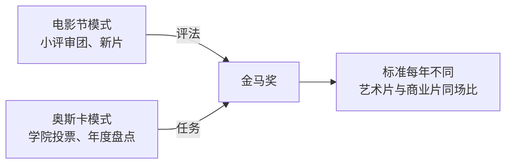
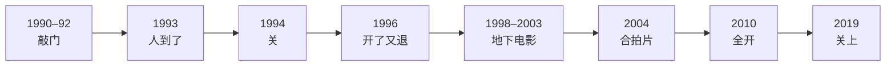
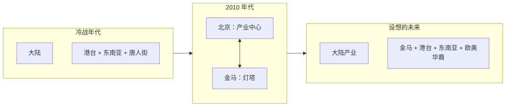

# 给 Claude Design 的交接文档｜电影巨辩 EP11《金马六十年，大陆与台湾》可视化

> 这份文档是自足的：不需要原始转录，也不需要另一份总结文档，照着这里的数据和文案就能做。
> 所有数据来自对播客 ASR 转录的整理。标了"节目口述""补注""推断"的内容请按标注处理，不要当成确定事实放大展示。

---

## 0. 任务

**要做什么**：把一期 3 小时的中文电影播客做成一组可视化，让没听过的人三分钟看懂脉络，听过的人能当索引用。

**这期在讲什么**：两位影评人（老马 / magasa，阿吴 / LOOK）在第 60 届金马奖之后，回顾这个奖从 1962 年到 2023 年的制度史。他们不评哪部片该得奖，只讲三件事：金马奖是一个什么性质的奖；它怎么从一个政治宣传工具，一步步变成面向全球华人的电影奖；它和大陆电影的关系怎么一小步一小步地打开，又怎么中断。

**一句话主旨**（可做主标题下的副题）：

> 三种政治环境下，能有几年不分彼此地评奖，本身就是一个奇迹。

**节目信息**

| 项 | 值 |
|---|---|
| 节目 | 电影巨辩 |
| 期数与标题 | 第 11 期《金马六十年，大陆与台湾》 |
| 主播 | 老马（magasa）、阿吴（LOOK） |
| 时长 | 3:02:30（182.2 分钟） |
| 语言 | 简体中文 |

**受众**：影迷、播客听众。默认读者知道金马奖和侯孝贤、李安是谁，但不了解金马的制度史，也不熟悉台湾 1960 至 1990 年代的政治背景。

**产出形式**：一个可滚动的长页面，由下面的模块组成；每个模块也要能单独截成一张竖版卡片（建议 4:5）。模块有优先级，时间不够先做 P0。

**这一期的骨架是一条时间线。** 主播把六十年分成八个阶段，全篇的主视觉应该是这条时间线（M7），其他模块都可以看作它的放大或切片。

---

## 1. 使用规则

1. **不用剧照、海报、人物肖像、奖杯的实拍或仿绘、金马奖的官方标志和字体。** 用抽象母题（见第 2 节）。
2. **不画地图，不出现任何旗帜、徽章、政党标志。** 这一期谈的是两岸关系，地图和旗帜怎么画都会引起不必要的争议。地区用色块和文字表示。
3. **颜色只代表地区或制度，不代表政治立场。** 特别注意：不要用蓝色和绿色来区分任何两个对象，这两种颜色在台湾语境里对应政党阵营。涉及党派的模块（M14）用灰色加文字。
4. **数字以本文件为准**，不要自己补充或改写。
5. **措辞保持中性。** 文案里一律写全名和职务（如"蒋介石""新闻局长"），不用节目里的口语代称。不对任何一方的政治选择下评语；主播的判断要标明是"主播认为"。
6. **两地的官方机构**统一写作"大陆主管部门""台湾新闻局"，不加定语。
7. 说话人归属：有原话为据的才写"老马""阿吴"，本文件已经标好；其余写"一方 / 另一方"。
8. 译名和人名用第 8 节的表。最容易错的一个：金马执委会执行长是**闻天祥**，不是"文天祥"。

---

## 2. 视觉方向

**气质**：一份做得很讲究的档案年表。沉稳、清楚、有一点旧报纸和电影胶片的质感。不要颁奖礼的金碧辉煌，也不要新闻图表的冷硬。

**色板与语义**（同一个对象全篇同一个颜色）

| 名称 | 色值 | 用在哪 |
|---|---|---|
| 鎏金 | `#C9A227` | 金马奖本身、主时间轴、"开放" |
| 茶紫 | `#5E548E` | 台湾电影 |
| 赭红 | `#B4472E` | 大陆电影 |
| 霓虹玫 | `#C2417A` | 香港电影 |
| 青石 | `#2A9D8F` | 东南亚与海外华人电影 |
| 墨黑 | `#1C1C1C` | 正文、"关闭"、"中断" |
| 铅灰 | `#8A8F93` | 官方机构、政治人物、中性信息 |
| 米纸 | `#F4EFE4` | 底色 |

颜色不能单独承担含义：四个地区同时要有文字标签；"开放 / 关闭"同时要有图形区别（如实心与空心、实线与虚线）。

**母题**（抽象几何，选用）

- 一条横贯全篇的金色时间轴，像胶片的片边，有齿孔
- 门：从关着、开一条缝、半开到全开，再到关上。这是"大陆电影怎么进来"的核心意象
- 阶梯或同心圆：表示报名资格一圈圈扩大
- 印章和档案夹的边角
- 一条抽象的奔跑线条（不是马的具象图形）

**字体建议**：标题用中文衬线体（如思源宋体），正文用无衬线体（如思源黑体），年份和数字用等宽或表格数字。年份是这一期最重要的视觉元素，要大、要清楚。

---

## 3. 模块总览

| # | 模块 | 建议形式 | 优先级 | 数据位置 |
|---|---|---|---|---|
| M1 | 封面 | 标题卡 | P0 | 4.1 |
| M2 | 十个要点 | 编号列表卡 | P0 | 4.2 |
| M3 | 全期脑图 | 树状或放射状脑图 | P0 | 4.3 |
| M4 | 三小时都聊了什么 | 按时间比例切分的横条 + "每年分到几分钟"小图 | P0 | 4.4 |
| M5 | 金马在哪：两种模式之间 | 三栏对照或位置图 | P0 | 4.5 |
| M6 | 为什么只能是金马 | 三地对比卡 | P1 | 4.6 |
| M7 | 八个阶段 | 主时间线（全篇主视觉） | P0 | 4.7 |
| M8 | 四条纵线 | 与 M7 同轴的四条泳道 | P0 | 4.8 |
| M9 | 评审制度折腾史 | 时间轴上的规则卡片 | P1 | 4.9 |
| M10 | 大陆电影的八道门 | 门的序列 | P0 | 4.10 |
| M11 | 1996：《阳光灿烂的日子》事件 | 纵向流程 | P1 | 4.11 |
| M12 | 金马亏待过谁 | 三位导演的受挫时间线 | P1 | 4.12 |
| M13 | 最佳剧情片去了哪里 | 按地区上色的点阵时间线 | P1 | 4.13 |
| M14 | 2002：钱从哪里来 | 金额对比 + 流程 | P2 | 4.14 |
| M15 | 每任主席留下了什么 | 累加的积木或书架 | P2 | 4.15 |
| M16 | 两次整合机遇 | 左右对照 | P2 | 4.16 |
| M17 | 三个时代的华语电影系统 | 三联图 | P0 | 4.17 |
| M18 | 提及频次 | 三组横向条形图 | P1 | 4.18 |
| M19 | 金句卡 | 大字引文，6–8 张 | P0 | 4.19 |
| M20 | 主播的分歧 | 正反卡片 | P2 | 4.20 |

建议的页面顺序：M1 → M2 → M3 → M4 → M5 → M6 → M7 + M8（合成一张大图）→ M9 → M10 → M11 → M12 → M13 → M14 → M15 → M16 → M17 → M18 → M20 → M19（金句也可以拆开，穿插在各模块之间）。

---

## 4. 各模块的数据与文案

### 4.1 M1 封面

- 主标题：金马六十年，大陆与台湾
- 眉题：电影巨辩 · 第 11 期
- 副题：一个电影奖，怎样被时势推着走了六十年
- 角标：老马 × 阿吴｜3 小时 02 分
- 视觉：一条金色时间轴从 1962 拉到 2023，上面有八个刻度；轴的后半段有一扇门，从开到合。

### 4.2 M2 十个要点

```json
[
  {"n": 1, "title": "百分之百的政治产物", "text": "1962 年创办，为的是推广国语片、争取香港影人、给领导人祝寿。"},
  {"n": 2, "title": "卡在两种模式中间", "text": "做的是奥斯卡式的年度盘点，用的是电影节式的小评审团。争议大多出在这里。"},
  {"n": 3, "title": "只能是金马", "text": "要办一个覆盖整个华语圈的奖，大陆的环境做不到，香港金像奖没有动机。"},
  {"n": 4, "title": "六十年，八个阶段", "text": "每一段的终点都是一次转折：1978、1984、1990、1996、2004、2010、2019。"},
  {"n": 5, "title": "改了几十次的评审制度", "text": "主题意识占分、导演一人两票、让记者看监控直播，都出现过。争议从没变小。"},
  {"n": 6, "title": "亏待新电影", "text": "侯孝贤在 1980 年代屡次全军覆没。1989 年《悲情城市》输掉最佳剧情片。"},
  {"n": 7, "title": "一小步一小步", "text": "从 1990 年开始邀请，到 2010 年纯大陆片可以自由报名，中间隔了二十年。"},
  {"n": 8, "title": "只有九年", "text": "真正的两岸三地同场竞技是 2010 到 2018 年。主播说，做不到反而是正常的。"},
  {"n": 9, "title": "两头受压", "text": "2002 年预算被冻结。“政治人物不上台、不致辞、不颁奖”的原则就是这样逼出来的。"},
  {"n": 10, "title": "重建坐标", "text": "2019 年之后转向全球华人。主播设想以金马为灯塔，再造一个华人电影系统。"}
]
```

### 4.3 M3 全期脑图

一级分支的颜色：立论用铅灰；一、二用墨黑（官办）；三用铅灰（过渡）；四到七用鎏金由浅到深（逐步开放）；八用青石（转向海外）。

```json
{
  "center": "金马六十年",
  "branches": [
    {"label": "立论", "children": ["第 60 届与“华语语系”", "两种模式之间", "为什么只能是金马", "小评审团 vs 学院投票", "老马的评审亲历"]},
    {"label": "一 1962–1977 政治宣传", "children": ["国语片与统战香港", "祝寿日颁奖、官员训话", "主题意识占分", "健康写实与政宣片", "亚洲影展与一场空难"]},
    {"label": "二 1978–1983 宋楚瑜改革", "children": ["专业化、国际化、艺术化", "两轮评选、现场揭晓", "金马影展与主题曲", "先肯定香港新浪潮"]},
    {"label": "三 1984–1989 官民合办", "children": ["十家公会轮流承办", "1985 拥侯与反侯", "《恋恋风尘》与《恐怖分子》", "1989《悲情城市》落败"]},
    {"label": "四 1990–1995 转为民办", "children": ["基金会与执委会", "监控直播评审", "外籍资格之争", "1993 大陆代表团访台"]},
    {"label": "五 1996–2003 单方面开放", "children": ["《阳光灿烂的日子》事件", "地下电影参赛", "蔡明亮、杨德昌退赛", "预算风波与“三不”"]},
    {"label": "六 2004–2009 合拍片通道", "children": ["借香港身份报名", "纯大陆片年年退赛", "语言不再是门槛", "电影学院与创投"]},
    {"label": "七 2010–2018 同场竞技", "children": ["纯大陆片放开", "台湾电影复苏", "肯定大陆独立电影", "港片被冷落"]},
    {"label": "八 2019– 重建坐标", "children": ["大陆撤出", "转向东南亚与海外", "再造一个系统"]}
  ]
}
```

### 4.4 M4 三小时都聊了什么

一条总长代表 182.2 分钟的横条，按下面的起止秒数切段。八个历史阶段用鎏金由浅到深，立论用铅灰，展望用青石。

```json
{
  "start_offset_seconds": 16,
  "end_seconds": 10950,
  "segments": [
    {"id": "A", "label": "开场：第 60 届与“华语语系”", "start": 16, "end": 434, "minutes": 7.0, "group": "立论"},
    {"id": "B", "label": "评审亲历与闻天祥", "start": 434, "end": 835, "minutes": 6.7, "group": "立论"},
    {"id": "C", "label": "两种模式之间", "start": 835, "end": 1077, "minutes": 4.0, "group": "立论"},
    {"id": "D", "label": "为什么只能是金马", "start": 1077, "end": 1626, "minutes": 9.2, "group": "立论"},
    {"id": "E", "label": "小评审团 vs 学院", "start": 1626, "end": 1894, "minutes": 4.5, "group": "立论"},
    {"id": "P1", "label": "一 1962–1977 政治宣传", "start": 1894, "end": 3141, "minutes": 20.8, "group": "历史"},
    {"id": "P2", "label": "二 1978–1983 宋楚瑜改革", "start": 3141, "end": 4049, "minutes": 15.1, "group": "历史"},
    {"id": "P3", "label": "三 1984–1989 官民合办", "start": 4049, "end": 5302, "minutes": 20.9, "group": "历史"},
    {"id": "P4", "label": "四 1990–1995 转为民办", "start": 5302, "end": 7025, "minutes": 28.7, "group": "历史"},
    {"id": "P5", "label": "五 1996–2003 单方面开放", "start": 7025, "end": 8435, "minutes": 23.5, "group": "历史"},
    {"id": "P6", "label": "六 2004–2009 合拍片通道", "start": 8435, "end": 9334, "minutes": 15.0, "group": "历史"},
    {"id": "P7", "label": "七 2010–2018 同场竞技", "start": 9334, "end": 10428, "minutes": 18.2, "group": "历史"},
    {"id": "P8", "label": "八 2019– 重建坐标", "start": 10428, "end": 10582, "minutes": 2.6, "group": "历史"},
    {"id": "Z", "label": "展望与结语", "start": 10582, "end": 10950, "minutes": 6.1, "group": "展望"}
  ],
  "groups": [
    {"group": "立论", "minutes": 31.4, "share": "17.2%"},
    {"group": "历史", "minutes": 144.8, "share": "79.5%"},
    {"group": "展望", "minutes": 6.1, "share": "3.4%"}
  ]
}
```

**附图："每年分到几分钟"**（八根柱子，横轴是阶段，纵轴是分钟每年）

```json
[
  {"phase": "一", "years": "1962–1977", "span_years": 16, "minutes": 20.8, "minutes_per_year": 1.3},
  {"phase": "二", "years": "1978–1983", "span_years": 6, "minutes": 15.1, "minutes_per_year": 2.5},
  {"phase": "三", "years": "1984–1989", "span_years": 6, "minutes": 20.9, "minutes_per_year": 3.5},
  {"phase": "四", "years": "1990–1995", "span_years": 6, "minutes": 28.7, "minutes_per_year": 4.8},
  {"phase": "五", "years": "1996–2003", "span_years": 8, "minutes": 23.5, "minutes_per_year": 2.9},
  {"phase": "六", "years": "2004–2009", "span_years": 6, "minutes": 15.0, "minutes_per_year": 2.5},
  {"phase": "七", "years": "2010–2018", "span_years": 9, "minutes": 18.2, "minutes_per_year": 2.0},
  {"phase": "八", "years": "2019–2023", "span_years": 5, "minutes": 2.6, "minutes_per_year": 0.5}
]
```

- 标注一句：讲得最细的是 1990 到 1995 年，刚转为民办、两岸开始接触的那六年。
- 小字：离现在最近的一段讲得最少，主播把篇幅留给了对未来的设想。

### 4.5 M5 金马在哪：两种模式之间

左右两端是两种成熟的模式，金马在中间，同时从两边各拿了一半。

```json
{
  "left": {
    "name": "电影节模式",
    "examples": "戛纳、威尼斯、柏林",
    "traits": ["全世界选片，多是没公映的新片", "小评审团，每年换人", "七八个奖，不强调技术工种", "偏爱作者风格的艺术电影"]
  },
  "right": {
    "name": "奥斯卡模式",
    "examples": "奥斯卡、香港金像奖、法国凯撒奖",
    "traits": ["盘点过去一年已公映的电影", "几百到几千人的学院集体投票", "几十个奖，技术门类分得很细", "偏爱有社会议题的商业类型片"]
  },
  "center": {
    "name": "金马奖",
    "from_left": ["小评审团，一二十人", "没上映的新片也可以报名"],
    "from_right": ["年度产业盘点", "设有多项技术奖"],
    "consequences": ["每年换一批评审，标准忽左忽右", "小评审团未必评得了技术门类", "艺术片和商业大片被放在一起比"]
  },
  "example": "2005 年，《最好的时光》《功夫》《天边一朵云》一起入围最佳剧情片。主播：这没有办法比较。",
  "caption": "主播认为这种评法全世界没有第二家。"
}
```

### 4.6 M6 为什么只能是金马

三张并排的卡片，前两张标"不能"，第三张标"能"。

```json
[
  {
    "region": "大陆",
    "color": "#B4472E",
    "award": "金鸡奖",
    "verdict": "不能",
    "reasons": ["奖项的设置和管理都在上层，主管部门自己也做不了主", "民间试过：《南方都市报》办的华语电影传媒大奖，评得好，但没能延续"]
  },
  {
    "region": "香港",
    "color": "#C2417A",
    "award": "金像奖（1982 年创办）",
    "verdict": "不能",
    "reasons": ["它是行业的自我表彰，核心荣誉不会给外地电影", "创办的动机之一就是对抗金马：当年港片去参赛，要先配成国语"]
  },
  {
    "region": "台湾",
    "color": "#5E548E",
    "award": "金马奖（1962 年创办）",
    "verdict": "能",
    "reasons": ["本地年产量一度只有二三十部，撑不起只评本地的奖，必须扩大", "1997 年后港片不能再算“国片”，转型势在必行", "环境允许"]
  }
]
```

- 底部一句：金马需要大陆电影，大陆电影圈也需要一个有公信力的奖。这个黄金时期只有几年。
- 关于传媒大奖的小卡（可选）：

```json
{
  "name": "华语电影传媒大奖",
  "host": "《南方都市报》",
  "span": "2001 年首届颁奖，2017 年改名，2019 年后不再举办",
  "features": ["评两岸三地和海外的华语电影", "不用报名，拍出来就可以评", "初审、复审、终审三轮；先讨论再投票", "没有技术奖"],
  "host_view": "主播之一称它“相当于大陆办的一个小金马奖”，评奖结果“经得起历史的考验”。",
  "lesson": "任何一个奖只有延续存在才有影响力，一旦中断，一切归零。"
}
```

### 4.7 M7 八个阶段（主视觉）

一条按真实年份比例绘制的横轴，1962 到 2023。八个色段，每段上方写名称，下方写一句话；段与段的交界处是一个"转折"标记。

```json
[
  {"n": 1, "name": "政治宣传", "start": 1962, "end": 1977, "organizer": "官办", "one_line": "为国语片、为统战、为祝寿", "turning_point": "1978 年宋楚瑜出任新闻局代局长"},
  {"n": 2, "name": "宋楚瑜改革", "start": 1978, "end": 1983, "organizer": "官办", "one_line": "把它改造成一个真正的电影奖", "turning_point": "预算受到威胁，新闻局交出承办权"},
  {"n": 3, "name": "官民合办", "start": 1984, "end": 1989, "organizer": "官方出钱，十家公会轮流承办", "one_line": "新电影与旧审美的战场", "turning_point": "新闻局决定彻底下放民间"},
  {"n": 4, "name": "转为民办", "start": 1990, "end": 1995, "organizer": "基金会主办，执委会筹办", "one_line": "李行当家，开始接触大陆影人", "turning_point": "香港回归在即，台湾产量见底"},
  {"n": 5, "name": "单方面开放", "start": 1996, "end": 2003, "organizer": "民办", "one_line": "门开了，来的是地下电影", "turning_point": "大陆宣布合拍片可以自由报名"},
  {"n": 6, "name": "合拍片通道", "start": 2004, "end": 2009, "organizer": "民办", "one_line": "借一个香港身份才能进来", "turning_point": "两岸关系改善，纯大陆片放开"},
  {"n": 7, "name": "同场竞技", "start": 2010, "end": 2018, "organizer": "民办", "one_line": "唯一无障碍的九年", "turning_point": "大陆撤出"},
  {"n": 8, "name": "重建坐标", "start": 2019, "end": 2023, "organizer": "民办", "one_line": "转向东南亚与全球华人", "turning_point": null}
]
```

- 分期是主播老马做的，图注写："分期：老马"。
- 两个需要在轴上单独标出的空档：1964 年和 1974 年金马停办（因为台湾当年承办亚洲影展）。

### 4.8 M8 四条纵线

和 M7 共用同一条年份轴，在它下面画四条泳道。每条泳道上只放节点，不写长句。

```json
{
  "lanes": [
    {
      "name": "谁在办",
      "nodes": [
        {"year": 1962, "label": "官办"},
        {"year": 1984, "label": "官民合办"},
        {"year": 1990, "label": "民办"},
        {"year": 2009, "label": "基金会与执委会关系理顺"}
      ]
    },
    {
      "name": "谁能报名",
      "nodes": [
        {"year": 1962, "label": "只收国语片"},
        {"year": 1985, "label": "非国语片可报"},
        {"year": 1987, "label": "第一部粤语原声港片"},
        {"year": 1991, "label": "外籍人士有条件参赛", "approx": true},
        {"year": 1996, "label": "华语片，不问产地"},
        {"year": 1997, "label": "定位：全球华语影片竞赛"},
        {"year": 1999, "label": "大陆片来者不拒"},
        {"year": 2007, "label": "华人主创过半即可，语言不限"}
      ]
    },
    {
      "name": "怎么评",
      "nodes": [
        {"year": 1962, "label": "一轮，主题意识占分"},
        {"year": 1978, "label": "两轮，现场揭晓"},
        {"year": 1985, "label": "取消主题意识，公布票数"},
        {"year": 1988, "label": "导演一人两票"},
        {"year": 1990, "label": "监控直播给记者", "approx": true},
        {"year": 1995, "label": "执委提名、评审计分"},
        {"year": 1997, "label": "改回一轮"},
        {"year": 2007, "label": "三阶段，沿用至今"}
      ]
    },
    {
      "name": "大陆电影",
      "nodes": [
        {"year": 1990, "label": "开始邀请影人"},
        {"year": 1993, "label": "代表团成行"},
        {"year": 1996, "label": "金马开放，大陆退出"},
        {"year": 1998, "label": "地下电影参赛"},
        {"year": 2004, "label": "合拍片可报"},
        {"year": 2010, "label": "纯大陆片放开"},
        {"year": 2019, "label": "撤出"}
      ]
    }
  ],
  "note": "approx 为 true 的节点，节目只说了大致时间"
}
```

- 一句话图注：报名的范围一直在扩大，从国语片，到华语片，到华人电影。

### 4.9 M9 评审制度折腾史

时间轴上的一排规则卡片。"离谱"的几张用墨黑底反白，其余用米纸底。

```json
[
  {"when": "1962–1977", "rule": "分项打分，“主题意识”占 22%，后来升到 25%", "tone": "odd", "note": "主播：相当于思想性"},
  {"when": "1962–1977", "rule": "没有提名，颁奖前就公布唯一的获奖者", "tone": "odd"},
  {"when": "1962–1977", "rule": "评审多是历史学者、音乐美术教授等跨界专家", "tone": "odd"},
  {"when": "1978", "rule": "两轮评选：先提名，再决选；现场揭晓", "tone": "normal"},
  {"when": "1985", "rule": "正式取消“主题意识”", "tone": "normal"},
  {"when": "1985", "rule": "对外公布每部影片的得票数和理由", "tone": "odd", "note": "主播：公开透明不等于专业"},
  {"when": "1988", "rule": "评审分组，导演组一人两票，其他人一票", "tone": "odd"},
  {"when": "1990", "rule": "评审全部用业内人士", "tone": "normal"},
  {"when": "1990 年代初", "rule": "先投票，再讨论", "tone": "odd", "note": "主播：都投完了，还讨论什么"},
  {"when": "1990 年代初", "rule": "评审会议用监控直播，记者在隔壁房间看", "tone": "odd", "note": "主播：全世界都没有这么搞的"},
  {"when": "1992", "rule": "业内 50%、影评人 20%、学者 15%、文化人 15%", "tone": "normal"},
  {"when": "1995", "rule": "执委会委员提名，评审团计分", "tone": "odd", "note": "主播：委员太忙，会找人代看"},
  {"when": "1997", "rule": "改回一轮，15 个人从头评到尾", "tone": "normal"},
  {"when": "2007", "rule": "初选、复选、决选三阶段", "tone": "normal"},
  {"when": "现在", "rule": "复审和终审在同一家影院统一看片，之前看过也不行", "tone": "normal"}
]
```

- 标题下的引文：为了减少外界对评审制度的争议，今年做了哪些改革。到了下一年，这句话又出现了。
- 结论句：只要是小评审团，就一定会有争议。

**1992 年评审构成的小图**（一根四段的横条）

```json
[
  {"group": "电影业内", "share": 50},
  {"group": "影评人", "share": 20},
  {"group": "学者", "share": 15},
  {"group": "文化人", "share": 15}
]
```

### 4.10 M10 大陆电影的八道门

一排八扇门，按时间从左到右。每扇门有一个状态：关、敲门、开一条缝、半开、全开、关上。同时用文字标状态，不要只靠图形。

```json
[
  {"when": "1990–1992", "state": "敲门", "title": "三次邀请，都没成", "detail": "有人在拍戏，有人身在国外不能直接赴台，有人到的时候已经闭幕"},
  {"when": "1993", "state": "开一条缝", "title": "29 人代表团出席第 30 届", "detail": "人到了，电影还不能参赛"},
  {"when": "1994", "state": "关", "title": "大陆编导演过半的影片不得参赛", "detail": "金马执委会自己的决议"},
  {"when": "1996", "state": "一边开一边关", "title": "金马开放，大陆全面退出", "detail": "大陆只许经批准的合拍片参加；一部未获批准的影片入围后，其余影片退赛"},
  {"when": "1998–2003", "state": "开一条缝", "title": "来的是地下电影", "detail": "《天浴》《蓝宇》《十七岁的单车》《盲井》"},
  {"when": "2004", "state": "半开", "title": "合拍片可以自由报名", "detail": "纯大陆出品的影片仍然不行，此后几年年年有影片被令退赛"},
  {"when": "2010", "state": "全开", "title": "纯大陆片放开", "detail": "此后九年，两岸三地无障碍同场竞技"},
  {"when": "2019", "state": "关上", "title": "大陆撤出", "detail": "金马转向东南亚与海外华人"}
]
```

- 引文：大陆对金马的放开，是一小步一小步的，没有一步到位。
- 小字：从第一次邀请到全面放开，用了二十年。

**2005–2009 年的小表**（放在第六扇门下面）

```json
[
  {"year": 2004, "in": ["《可可西里》"], "out": []},
  {"year": 2005, "in": ["《天下无贼》"], "out": ["《求求你表扬我》", "《心急吃不了热豆腐》"]},
  {"year": 2006, "in": ["《疯狂的石头》"], "out": ["《吴清源》"]},
  {"year": 2007, "in": ["《落叶归根》", "《太阳照常升起》"], "out": ["《图雅的婚事》", "《苹果》", "《盲山》"]},
  {"year": 2008, "in": ["《集结号》"], "out": []},
  {"year": 2009, "in": ["《斗牛》", "《疯狂的赛车》", "《梅兰芳》"], "out": []}
]
```

图注：报名成功的大陆片，背后都有一个香港或外资的出品身份。

### 4.11 M11 1996：《阳光灿烂的日子》事件

纵向十步流程。

```json
[
  "金马宣布向大陆电影开放",
  "金马代表团到大陆，劝说放行",
  "大陆同意，但有约定：只准合拍片，片单须经批准",
  "10 部大陆影片报名",
  "提名公布，名单里有《阳光灿烂的日子》",
  "大陆主管部门表示没有批准这部影片，要求撤片",
  "报名的台湾片方拒绝；金马认为报名符合规则",
  "大陆全面退出这一届，7 部影片退赛",
  "留下 3 部合拍片",
  "《阳光灿烂的日子》拿下多个大奖，主创没有到场"
]
```

**三个数字**

```json
[
  {"value": "10", "label": "部报名"},
  {"value": "7", "label": "部退赛"},
  {"value": "3", "label": "部留下"}
]
```

- 引文（节目转述李行）：政治上的事情让政治家去操心，我们可以先让两岸的电影统一起来。
- 主播的评语，排小字：事实证明这非常难。文化的整合也受制于政治，很难超前进行。

### 4.12 M12 金马亏待过谁

三条并排的短时间线，每个节点一张小卡。最后一个节点如果是和解，用鎏金。

```json
{
  "directors": [
    {
      "name": "侯孝贤",
      "events": [
        {"year": 1983, "text": "《儿子的大玩偶》全军覆没"},
        {"year": 1984, "text": "《风柜来的人》《冬冬的假期》全军覆没"},
        {"year": 1985, "text": "《童年往事》只得剧本奖"},
        {"year": 1986, "text": "《恋恋风尘》全军覆没"},
        {"year": 1989, "text": "《悲情城市》输掉最佳剧情片"},
        {"year": 2002, "text": "金马预算被冻结，他说宁可停掉辅导金也要保住金马", "tone": "turn"},
        {"year": 2009, "text": "出任金马执委会主席，办电影学院", "tone": "reconcile"}
      ],
      "quote": "金马奖恨我，我也恨金马奖。"
    },
    {
      "name": "杨德昌",
      "events": [
        {"year": 1986, "text": "《恐怖分子》拿下最佳剧情片，导演奖却没有入围"},
        {"year": 1991, "text": "《牯岭街少年杀人事件》拿下最佳剧情片"},
        {"year": 1996, "text": "宣布退出金马", "approx": true},
        {"year": 2000, "text": "《一一》没有报名。主办方来电相请，他说把机会留给年轻人", "tone": "exit"}
      ],
      "quote": null
    },
    {
      "name": "蔡明亮",
      "events": [
        {"year": 1994, "text": "《爱情万岁》是大赢家"},
        {"year": 1997, "text": "《河流》被评审贬损，全军覆没"},
        {"year": 1998, "text": "《洞》退赛，被罚三年不得报名", "tone": "exit"},
        {"year": 2006, "text": "《黑眼圈》被评审教训“要考虑票房和观众”，再次退赛", "tone": "exit"},
        {"year": 2009, "text": "《脸》重新报名，理由是给侯孝贤面子", "tone": "turn"},
        {"year": 2013, "text": "《郊游》拿到最佳导演", "tone": "reconcile"}
      ],
      "quote": null
    }
  ],
  "note": "引文为节目转述，不是采访原话。排版时写“节目转述”。"
}
```

- 标题下的小字：小评审团每年换人，美学取向就完全不一样。
- 侯孝贤那条线旁可以放一句主播的评语：侯导对金马是爱恨交织。

### 4.13 M13 最佳剧情片去了哪里

一条年份轴，每个年份一个圆点，按出品地区上色（用第 2 节的四个地区色）。**只画节目里提到的年份**，没提到的年份留空，不要自己补。

```json
[
  {"year": 1962, "film": "《星星月亮太阳》", "region": "香港"},
  {"year": 1963, "film": "《梁山伯与祝英台》", "region": "香港"},
  {"year": 1965, "film": "《养鸭人家》", "region": "台湾"},
  {"year": 1978, "film": "《汪洋中的一条船》", "region": "台湾"},
  {"year": 1980, "film": "《早安台北》", "region": "台湾"},
  {"year": 1984, "film": "《老莫的第二个春天》", "region": "台湾"},
  {"year": 1985, "film": "《我这样过了一生》", "region": "台湾"},
  {"year": 1986, "film": "《恐怖分子》", "region": "台湾"},
  {"year": 1987, "film": "《稻草人》", "region": "台湾"},
  {"year": 1988, "film": "《七小福》", "region": "香港"},
  {"year": 1989, "film": "《三个女人的故事》", "region": "香港"},
  {"year": 1991, "film": "《牯岭街少年杀人事件》", "region": "台湾"},
  {"year": 1993, "film": "《喜宴》", "region": "台湾"},
  {"year": 1996, "film": "《阳光灿烂的日子》", "region": "大陆", "note": "合拍片"},
  {"year": 2011, "film": "《赛德克·巴莱》", "region": "台湾"},
  {"year": 2012, "film": "《神探亨特张》", "region": "大陆"},
  {"year": 2013, "film": "《爸妈不在家》", "region": "东南亚与海外", "note": "新加坡"},
  {"year": 2016, "film": "《八月》", "region": "大陆"},
  {"year": 2017, "film": "《血观音》", "region": "台湾"},
  {"year": 2018, "film": "《大象席地而坐》", "region": "大陆"}
]
```

要点出的两件事：

1. 1965 年到 1987 年之间，节目提到的最佳剧情片全是台湾片。主播说，从第三届起到 1988 年《七小福》，再没有港片拿过这个奖。
2. 2013 年那个青石色的点。那一届的对手是《天注定》《一代宗师》《郊游》《毒战》，最后赢的是一位新加坡导演的第一部长片。

图注必须写：仅含节目中提到的年份。

**2018 年的小图**（两排各五个格子）

```json
{
  "best_feature_nominees": {"大陆": 4, "台湾": 1},
  "best_director_nominees": {"大陆": 5, "台湾": 0},
  "caption": "2018 年。台湾有人问：这到底是金鸡奖还是金马奖？"
}
```

### 4.14 M14 2002：钱从哪里来

**金额对比**（两根柱子，或一根柱子里切出一块）

```json
{
  "currency": "新台币",
  "annual_need": {"label": "金马一届的实际开销", "text": "五六千万"},
  "subsidy": {"label": "新闻局每年的补贴", "text": "一千几百万"},
  "ratio_text": "约四分之一",
  "sponsor_2002": {"label": "2002 年高雄市政府的赞助", "actual": "1000 万", "claimed": "1500 万"},
  "note": "都是主播口述的约数，图上显示文字，不显示精确数值"
}
```

**流程**（六步）

```json
[
  "有民意代表质疑：台湾电影在金马拿不到奖，办它做什么",
  "新闻局冻结金马预算",
  "高雄市政府出资，颁奖礼移到高雄",
  "主办城市希望政治人物上台",
  "金马以“三不”原则拒绝",
  "次年补贴被删，由另一座城市和企业接手"
]
```

**"三不"原则卡**

```json
{
  "title": "三不",
  "items": ["不上台", "不致辞", "不颁奖"],
  "explain": "欢迎政治人物出席，但只坐在台下。",
  "why": "主播：全世界的电影颁奖有政治人物出场很常见。只是华语地区情况太特殊，他们一上台，就摆不平了。"
}
```

这个模块全部用铅灰和墨黑，不用任何彩色区分阵营，也不出现政治人物的姓名。

### 4.15 M15 每任主席留下了什么

一个逐层累加的图形（书架、积木或年轮），每任主席加一层。

```json
[
  {"chair": "焦雄屏", "from": 2007, "legacy": ["金马创投", "华人主创过半即可报名", "三阶段评审"]},
  {"chair": "侯孝贤", "from": 2009, "legacy": ["创投百万首奖", "金马电影学院", "金马奇幻影展"]},
  {"chair": "张艾嘉", "from": null, "legacy": ["青少年观影团"]},
  {"chair": "李安", "from": null, "legacy": ["经典影展", "大师课"]},
  {"chair": "李屏宾", "from": null, "legacy": ["主播：还需要再看一看"]}
]
```

- from 为 null 的，节目没有说上任年份，图上不要标年份。
- 旁注（主播的小担心）：每任主席都加一个单元，后任又不好意思取消，几十年后办得过来吗？
- 可以在最底下加一层更早的地基：宋楚瑜（1978 年起，新闻局）留下了金马影展、主题曲和现场揭晓；李行（1990 年起，首任执委会主席）留下了两岸电影交流和"三不"原则。

### 4.16 M16 两次整合机遇

左右对照，各自最后落在"没有实现"。

```json
[
  {
    "when": "1990 年代前期",
    "model": "台湾出钱，香港出人，大陆出场地",
    "symbol": "台湾片商投资大陆第五代导演",
    "hope": "有人以为可以实现一体化",
    "why_not": "大陆当时还没有电影产业，正在从计划经济转向市场经济"
  },
  {
    "when": "2008–2016 年前后",
    "model": "两岸合拍片进入大陆市场",
    "symbol": "合拍片《大灌篮》在大陆春节档票房过亿",
    "hope": "台湾希望合拍片能占到大陆票房的 7%",
    "why_not": "政治上的障碍始终没有解决；台湾缺少类型片和大片的制作能力"
  }
]
```

- 引文：欧盟一体化的基础，首先是政治，是价值观，不是语言，也不是货币。

### 4.17 M17 三个时代的华语电影系统

三联图，从左到右。每一联里用圆和连线表示"谁是中心、谁和谁相连"。第三联用虚线，表示是设想。

```json
[
  {
    "era": "冷战年代",
    "nodes": [
      {"name": "大陆电影", "color": "#B4472E", "role": "关起门来自己做", "linked": false},
      {"name": "港台", "color": "#C2417A", "role": "海外华语电影的中心", "linked": true},
      {"name": "东南亚华人区", "color": "#2A9D8F", "role": "市场与人才", "linked": true},
      {"name": "欧美唐人街", "color": "#2A9D8F", "role": "市场", "linked": true}
    ],
    "caption": "两个互不往来的系统"
  },
  {
    "era": "2010 年代",
    "nodes": [
      {"name": "北京", "color": "#B4472E", "role": "大华语电影的产业中心", "linked": true},
      {"name": "金马奖", "color": "#C9A227", "role": "奖项的灯塔", "linked": true}
    ],
    "caption": "一个产业中心，一座灯塔，互补"
  },
  {
    "era": "主播设想的未来",
    "nodes": [
      {"name": "大陆电影产业", "color": "#B4472E", "role": "自成体系", "linked": false},
      {"name": "金马奖", "color": "#C9A227", "role": "另一个系统的灯塔", "linked": true},
      {"name": "港台", "color": "#C2417A", "role": "两地重新互动", "linked": true},
      {"name": "东南亚", "color": "#2A9D8F", "role": "已经有成绩", "linked": true},
      {"name": "欧美新一代华裔", "color": "#2A9D8F", "role": "还没有太大动静，可以期待", "linked": true}
    ],
    "caption": "和冷战年代相似，但欧美那一块不再是唐人街"
  }
]
```

- 第三联下方的引文：承载文化的主体是人，不是那些抽象的宏大的东西。
- 小字："以上是主播的设想，不是预测。"
- 一个历史类比，可做成第一联的脚注：在大陆与外界相对隔绝的年代，大陆以外的华人社区诞生了黄金时期的香港商业电影，也诞生了台湾艺术电影的高峰。这和市场人口不成正比。

### 4.18 M18 提及频次

三组横向条形图。统计方法：对转录全文做匹配，合并同一对象的各种错字变体。**数字是近似值，图下加一行"转录文本统计，约数"。**

```json
{
  "people": [
    {"name": "李行", "count": 60},
    {"name": "侯孝贤", "count": 44},
    {"name": "宋楚瑜", "count": 29},
    {"name": "蔡明亮", "count": 26},
    {"name": "焦雄屏", "count": 23},
    {"name": "杨德昌", "count": 16},
    {"name": "蒋介石", "count": 15},
    {"name": "闻天祥", "count": 12},
    {"name": "朱延平", "count": 12},
    {"name": "李安", "count": 11},
    {"name": "邱复生", "count": 11}
  ],
  "concepts": [
    {"name": "评审", "count": 132},
    {"name": "大陆电影", "count": 79},
    {"name": "提名 / 入围", "count": 74},
    {"name": "香港电影", "count": 57},
    {"name": "台湾电影", "count": 49},
    {"name": "产业", "count": 46},
    {"name": "政治", "count": 46},
    {"name": "华语电影", "count": 42},
    {"name": "报名", "count": 39},
    {"name": "新电影", "count": 26},
    {"name": "争议", "count": 24},
    {"name": "合拍片", "count": 22}
  ],
  "films": [
    {"name": "《阳光灿烂的日子》", "count": 9},
    {"name": "《悲情城市》", "count": 7},
    {"name": "《赛德克·巴莱》", "count": 6},
    {"name": "《恐怖分子》", "count": 6},
    {"name": "《恋恋风尘》", "count": 6},
    {"name": "《三个女人的故事》", "count": 6}
  ],
  "years_by_phase": [
    {"phase": "1962 年以前", "count": 4},
    {"phase": "一", "count": 11},
    {"phase": "二", "count": 16},
    {"phase": "三", "count": 21},
    {"phase": "四", "count": 21},
    {"phase": "五", "count": 27},
    {"phase": "六", "count": 24},
    {"phase": "七", "count": 25},
    {"phase": "八", "count": 9}
  ],
  "top_years": [
    {"year": 2010, "count": 9},
    {"year": 1985, "count": 8},
    {"year": 1990, "count": 8},
    {"year": 1996, "count": 8},
    {"year": 2000, "count": 8},
    {"year": 2009, "count": 7}
  ]
}
```

可以点出的四个发现：

1. "评审"出现 132 次，是这一期真正的关键词。
2. 被提到最多的人是李行（60 次），比侯孝贤多三分之一。
3. 前五名里，三位当过金马执委会主席，一位是改革它的官员，一位是和它冲突最多的导演。
4. 被提到最多的几部电影，都是引发了事件的电影。

"金马"一词本身出现约 497 次，平均每 22 秒一次，可以做成一个单独的大数字，不要放进条形图。

### 4.19 M19 金句卡

大字，一卡一句。来源说明排成小字。

```json
[
  {"text": "金马奖的创办，是百分之百的政治的产物。", "source": "主播"},
  {"text": "能有那么几年不分彼此地评奖，这本身就是一个奇迹。做不到反而是正常的。", "source": "主播"},
  {"text": "任何一个奖只有延续存在，才有影响力。一旦中断，一切归零。", "source": "主播"},
  {"text": "粽子包子什么都卖，但坚决不卖汉堡。", "source": "节目转述闻天祥对金马定位的比喻"},
  {"text": "只要是小评审团，就一定会有争议。", "source": "主播"},
  {"text": "公开透明不等于专业水平高。", "source": "主播"},
  {"text": "金马奖恨我，我也恨金马奖。", "source": "节目转述侯孝贤"},
  {"text": "文化的整合也是受制于政治的，它很难超前进行。", "source": "主播"},
  {"text": "电影终究是影像的，对白不是决定性的要素。", "source": "主播"},
  {"text": "承载文化的主体是人，不是那些抽象的宏大的东西。", "source": "主播"},
  {"text": "维系华人的到底是什么？不一定是语言，甚至不一定是传统文化。", "source": "主播"}
]
```

### 4.20 M20 主播的分歧

正反卡片，中间写结果。

```json
[
  {
    "topic": "大陆能不能办成一个统合华语电影的奖？",
    "side_a": {"who": "老马", "text": "环境不具备条件。"},
    "side_b": {"who": "阿吴", "text": "不完全同意。华语电影传媒大奖就是一次尝试，而且办得不错。"},
    "result": "老马：这次努力值得肯定。但它办不下去，恰恰说明这件事做不到。"
  },
  {
    "topic": "2009 年两位演员并列影帝，合理吗？",
    "side_a": {"who": "一方", "text": "有点勉强。"},
    "side_b": {"who": "另一方", "text": "香港和大陆是两套表演系统，第一次同场，没法比高低。"},
    "result": "互补。"
  },
  {
    "topic": "金马冷落了香港电影吗？",
    "side_a": {"who": "一方", "text": "是。2010 到 2018 年的新导演提名，台湾 21、大陆 15、香港只有 5。"},
    "side_b": {"who": "另一方", "text": "同意有这个现象。不过你举的两部片是 2019 年之后的，应该根本没有报名。"},
    "result": "判断一致，例子被当场纠正。"
  },
  {
    "topic": "规则放宽到“华人主创”之后，谁算华人？",
    "side_a": {"who": "一方", "text": "混血怎么算？将来一定会碰到敏感地带。"},
    "side_b": {"who": "另一方", "text": "有华人血统就可以，外籍导演拍的华语片也该算。"},
    "result": "没有结论。"
  },
  {
    "topic": "华语电影共同体，还做不做？",
    "side_a": {"who": "一方", "text": "现阶段是不是不可行，或者没有意义？"},
    "side_b": {"who": "另一方", "text": "可以做，金马也不会放弃。但它不是最终目的，最终是具体的人之间的连接。"},
    "result": "互补。"
  }
]
```

**新导演提名的小图**（配第三张卡）

```json
{"period": "2010–2018", "台湾": 21, "大陆": 15, "香港": 5, "source": "主播口述"}
```

---

## 5. 收尾模块的文案

- 小标题：记录一个族群的流变
- 正文（三句，可拆三行）：
  1. 这个世纪，华人更汹涌地散入世界的各个角落。
  2. 金马可以记录他们的思想和观念怎样流变。
  3. 也可以记录，在这个时代，维系他们的到底是什么。

---

## 6. 结构草图（Mermaid，仅供理解关系，不是最终样式）

**两种模式之间**



**大陆电影的八道门**



**三个时代**



---

## 7. 模块之间的呼应

- **一条金色的轴**：M1 封面上的时间轴，就是 M7 的主时间线，也是 M8、M9、M10、M12、M13 共用的横轴。能对齐的尽量对齐，让读者感觉在同一条线上上下移动。
- **门**：M1 封面上的那扇门，在 M10 里展开成八扇；M17 第三联里，大陆和另一个系统之间画一扇关着但没上锁的门（主播说双方"其实没有断"）。
- **四个地区色**：M6、M13、M17、M20 的小图里，四个地区的颜色不要换。
- **九年**：M7 的第七段、M10 的第七扇门、M2 的第八条，是同一个数字。
- **2013 年的那个点**：M13 里唯一的青石色圆点，对应 M17 第三联里的"东南亚"。可以用一条细线把两处连起来。

---

## 8. 人名与译名统一表

| 统一写法 | 说明 | 不要写成 |
|---|---|---|
| 金马奖 / 金马影展 | Golden Horse Awards | 金马银展 |
| 金马执委会 | 全称"台北金马影展执行委员会" | 职委会 |
| 电影事业发展基金会 | 文中简称"基金会" | |
| 新闻局 | 台湾当时的电影主管机关 | |
| 闻天祥 | 金马执委会执行长，2009 年起 | 文天祥 |
| 李行 | 导演，首任执委会主席 | 理行 |
| 侯孝贤 | | 侯岛 |
| 焦雄屏 | 影评人、制片人，2007 年起任主席 | 焦雄平 |
| 宋楚瑜 | 1978 年起任新闻局代局长、局长 | |
| 邵玉铭 | 1989 年前后的新闻局长 | |
| 邱复生 | 年代公司，1995 年任主席 | 邱富生 |
| 徐枫 | 汤臣公司 | 徐峰 |
| 朱延平 | 2009 年起任基金会董事长 | 朱元平 |
| 李屏宾 | 摄影师，现任主席 | 李平斌 |
| 张艾嘉 | | |
| 杜可风 | 摄影师 | 杜可峰 |
| 陈哲艺 | 《爸妈不在家》导演 | 陈泽义 |
| 章国明 | 《边缘人》导演 | 张国明 |
| 《牯岭街少年杀人事件》 | | 孤岭街 |
| 《三个女人的故事》 | 香港片名《人在纽约》，全篇统一用前者，首次出现时括注 | |
| 《赛德克·巴莱》 | | |
| 《背靠背，脸对脸》 | | |
| 《大象席地而坐》 | | |
| 华语电影传媒大奖 | | 传媒奖 |
| 华语语系 | Sinophone | |
| 健康写实 | 1960 年代台湾的制片路线 | |
| 新电影 | 指 1980 年代的台湾新电影 | 新浪潮（那是香港的说法） |
| 合拍片 | | 和拍片 |
| 地下电影 | 指未经大陆主管部门批准而参展参赛的影片 | 禁片（范围不同，不要混用） |

---

## 9. 需要留意的事实

下面几处已经按稳妥的方式写进了各模块，这里说明原因，避免做图时改回去。

| 涉及模块 | 情况 | 处理 |
|---|---|---|
| M12 | 节目说 1989 年《悲情城市》输给了《三个女人的故事》 | 输掉的是最佳剧情片，侯孝贤当届拿了最佳导演。所以卡片写"输掉最佳剧情片"，不要写成"颗粒无收" |
| M13 | 节目说 1982 年《边缘人》"赢了"侯孝贤 | 那指的是最佳导演，当年的最佳剧情片是另一部。所以 1982 年没有放进点阵 |
| M13 | 1998 年《天浴》、2000 年《卧虎藏龙》、2004 年《可可西里》 | 节目提到它们"大获全胜"或"标志性"，但没有明说拿的是最佳剧情片，所以没有放进点阵。不要自己补 |
| M10 / M8 | 2004 年合拍片放开、2010 年纯大陆片放开 | 这两个节点是主播分期的依据，我没有找到可直接引用的官方文件。图上按节目说法画，图注写"据节目" |
| M10 | 2019 年大陆撤出 | 节目没有交代经过。公开报道的时间是 2019 年 8 月 7 日。图上只写"2019 撤出"，不写原因 |
| M6 | 华语电影传媒大奖的起止 | 节目说 2000 年创办、2020 年消失；查到的首届颁奖是 2001 年，最后一届是 2019 年。本文件用的是后一组 |
| M14 | 所有金额 | 都是主播口述的约数。显示文字（"五六千万"），不显示数字刻度 |
| M9 | 1990 年代初的两条规则 | 节目只说是李行任内，没有给具体年份 |
| M16 | 第二次机遇的时间 | 节目说的是"马英九时期"，本文件为保持中性写成了年份区间 |
| M18 | 所有频次 | 转录文本的近似统计，不要做成带小数的精确图 |

---

## 10. 不要做的事

- 不要生成任何真实人物的肖像，包括主播、导演、演员和政治人物。
- 不要画地图、旗帜、徽章，不要用金马奖的官方标志或仿绘奖杯。
- 不要用蓝色和绿色区分任何对象。
- 不要给两岸任何一方的政策选择配上褒贬色彩的图形（比如给一方画上锁链、高墙，给另一方画上阳光）。"门"的意象只表示状态，开和关都用同样克制的画法。
- 不要把主播的设想（M17 第三联）画成既成事实，用虚线和"设想"字样。
- 不要在 M13 里补上节目没提到的年份。
- 不要把 M14 做成带党派色彩的对立图。
